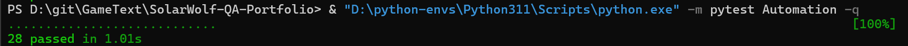

# SolarWolf pytest 自动化测试执行记录 — 第 01 轮

## 执行信息

| 项目 | 记录 |
| --- | --- |
| 执行方式 | 项目作者在本地 PowerShell 手动执行 |
| 测试命令 | `python -m pytest Automation -q` |
| pytest 版本 | 9.1.1 |
| 测试类型 | Python 白盒逻辑测试与小范围交互流程测试 |
| GUI 范围 | 不启动完整全屏游戏循环；不将结果表述为完整 GUI 或全游戏回归测试。 |

## 执行结果

| 运行 | 实际结果 | 说明 |
| --- | --- | --- |
| Baseline | `19 passed in 0.98s` | 三个基础自动化测试文件首次执行结果。 |
| Run 01 | `24 passed in 0.82s` | 增加飞船接触道具并触发效果的完整流程测试后执行。 |
| Run 02 | `28 passed in 1.03s` | 增加火球随机开火、火球创建和特殊道具阈值生成测试后执行。 |
| Run 03 | `28 passed in 1.01s` | 最终复核运行；完整显示执行命令与测试结果。 |

最终有效结果为 **28 passed in 1.01s**。

## 当前自动化覆盖范围

| 文件 | 覆盖逻辑 |
| --- | --- |
| `test_movement.py` | 飞船方向与边界、护盾加速、火球移动与离场移除、特殊道具跨边界移动。 |
| `test_interactions.py` | 黄色小方块有效接触、清屏与护盾效果、飞船接触道具后的完整触发链、火球随机开火/创建、特殊道具阈值生成。 |
| `test_saves.py` | 同名存档的唯一标识、临时存档保存读取、独立性、起始关卡读取。 |

## 证据

- [`../Evidence/Automation/Automation-Run-03-28-passed.png`](../Evidence/Automation/Automation-Run-03-28-passed.png)：最终复核截图，完整显示执行命令与 28 条测试通过结果。

## 结论边界

- 28 条测试均通过，证明当前覆盖的逻辑与交互流程在测试构造条件下符合预期。
- 自动化测试不替代已完成的手工黑盒测试，也不证明 SolarWolf 所有 GUI、全部关卡或所有随机组合均无缺陷。
