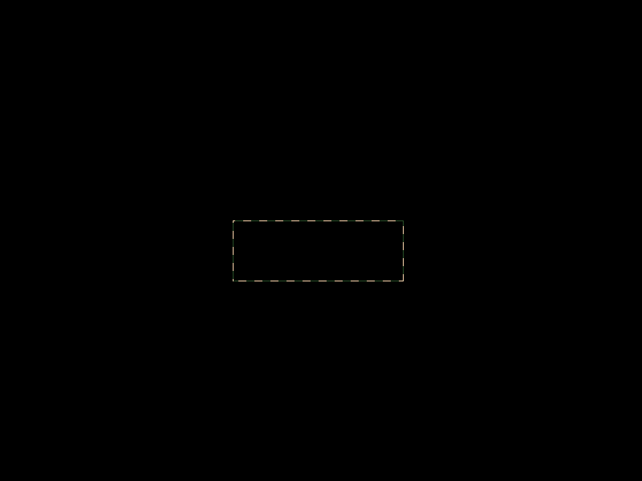
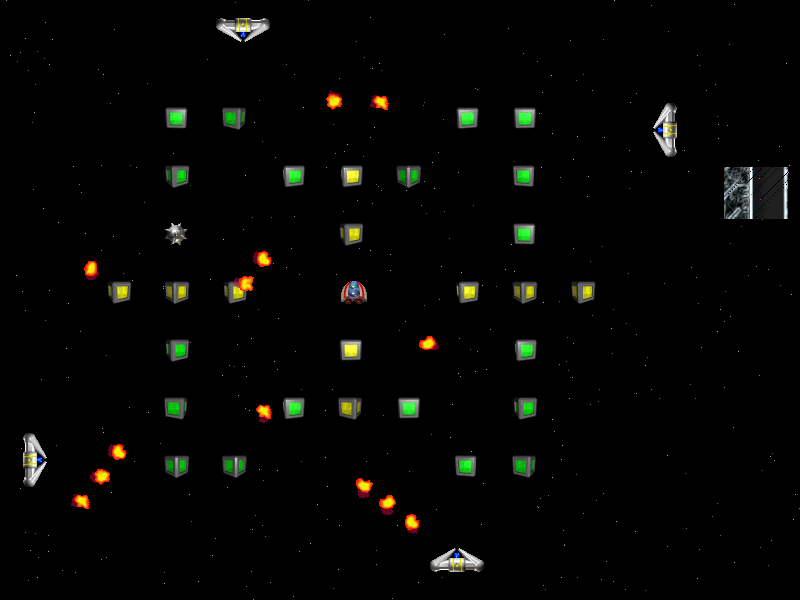

# BUG-UI-001 — 切换窗口返回后右侧 HUD 未完整重绘

## 基本信息

| 字段 | 内容 |
| --- | --- |
| 缺陷编号 | BUG-UI-001 |
| 模块 | UI / HUD / 暂停与窗口焦点 |
| 严重性 | 高 |
| 优先级 | 高 |
| 复现率 | 稳定复现 |
| 状态 | 已确认，待回归验证 |
| 发现日期 | 2026-09-29 |

## 测试环境

| 字段 | 内容 |
| --- | --- |
| 操作系统 | Windows 11 家庭中文版，64 位，Build 26200 |
| Python | 3.11.9 |
| Pygame | 2.6.1 |
| 游戏 | SolarWolf 1.6.0 |
| 显示模式 | 全屏，800 × 600 像素 |

## 前提条件

1. 启动游戏并进入正常可操作的关卡。
2. 右侧 HUD 正常显示计时器、生命和关卡信息。

## 复现步骤

### 路径 A：已有暂停提示时

1. 使游戏进入显示 `Paused / Press Any Key To Continue` 的暂停状态。
2. 切换到其他窗口或应用。
3. 再切换回 SolarWolf。

### 路径 B：首次切换窗口后再次返回

1. 在正常游戏状态下切换到其他窗口或应用。
2. 切换回 SolarWolf，确认游戏显示正常暂停提示。
3. 再次切换到其他窗口或应用。
4. 再次切换回 SolarWolf。

## 预期结果

游戏返回前台后应完整恢复当前游戏画面，包括右侧 HUD 的计时器、剩余生命、关卡信息及暂停提示区域。

## 实际结果

游戏画面未完整重绘。可出现黑色背景、仅保留部分暂停提示边框，或右侧 HUD 仅局部刷新，导致计时器、剩余生命和关卡信息无法正常查看。

## 影响说明

玩家无法可靠获取剩余时间与剩余生命等关键游戏状态，可能直接影响继续游玩与决策，因此评定为高严重性、高优先级。

## 证据

- [异常暂停提示区域截图](../Evidence/Bug-UI-001/BUG-UI-001-02-incomplete-pause-panel.png)
- [右侧 HUD 未完整重绘截图](../Evidence/Bug-UI-001/BUG-UI-001-03-incomplete-hud-redraw.png)
- [正常暂停返回界面记录（复现上下文）](../Evidence/Game-Records/Game-Record-03-focus-return-paused.png)

## 初步源码分析（非根因结论）

窗口失焦后，`main.py` 的焦点事件会调用当前游戏处理器的 `lostfocus()`；`gameplay.py` 随后创建 `GamePause` 暂停处理器。`gamepause.py` 仅将暂停提示自身区域标记为需要刷新，而 `gfx.py` 使用脏矩形列表进行局部显示更新；HUD 的计时器也以局部区域刷新。

目前未观察到焦点返回时强制重绘完整游戏区域与 HUD 的处理。该机制与实际出现的局部重绘现象一致，但仍需以修复前后的构建版本或更细粒度的运行时验证来确认，不能视为已确认根因。

## 回归要求

在后续对 SolarWolf 源码作出修复，或更换测试环境后，分别按路径 A 与路径 B 重复执行。只有两条路径均能完整恢复 HUD 和暂停区域，才可将本缺陷标记为“已修复 / 回归通过”。
