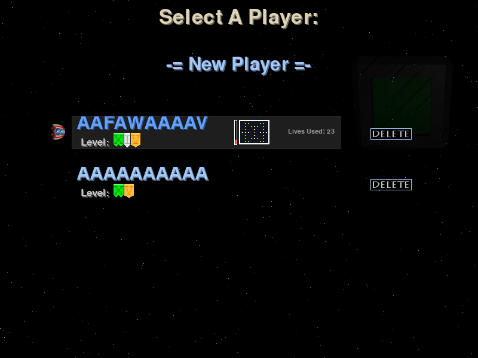
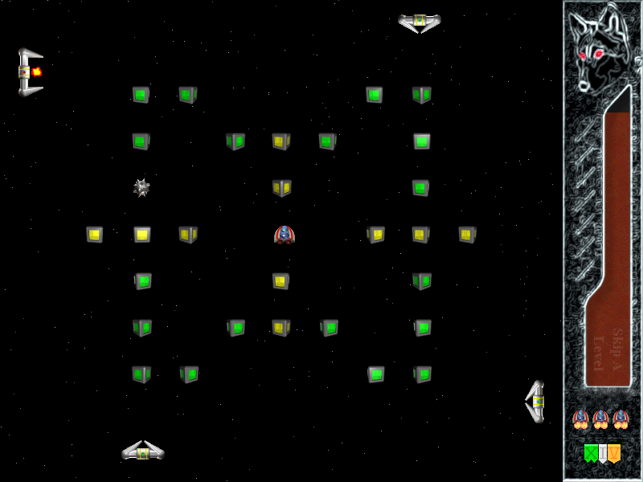
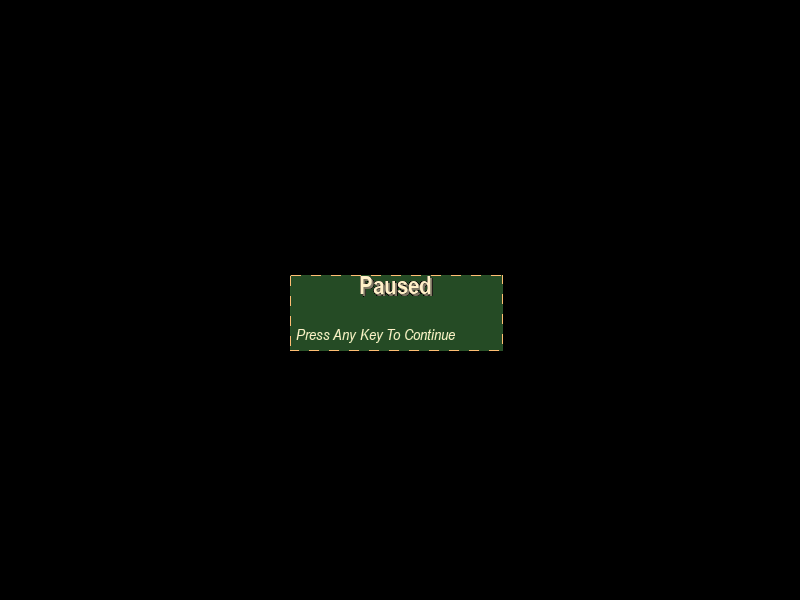
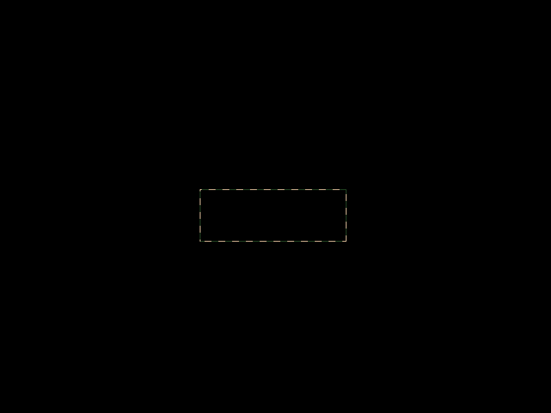
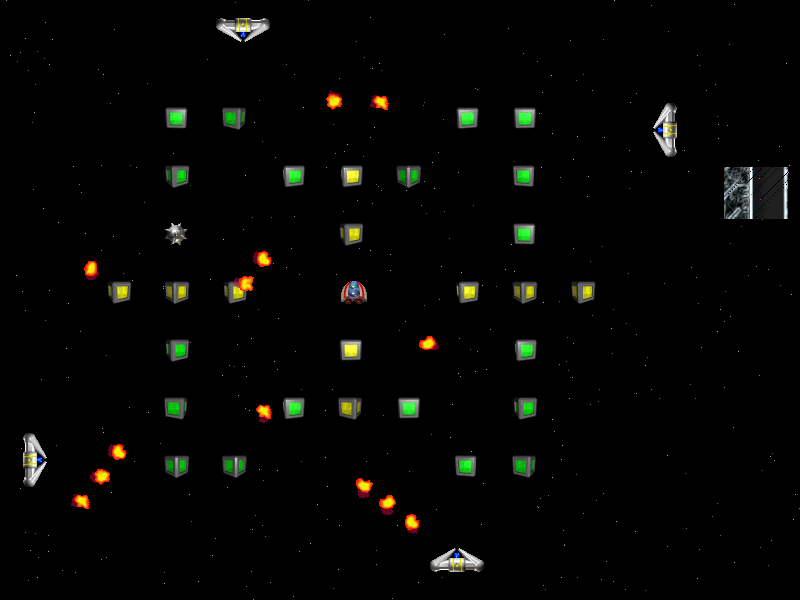

# SolarWolf 探索性测试记录 — 第 01 轮

## 测试范围与真实性说明

- **被测游戏（Game Under Test）：** SolarWolf。该游戏为 Pete “ShredWheat” Shinners 创作的开源 Python/Pygame 动作游戏。SolarWolf 是本项目的被测对象，并非本作品集作者开发的游戏。
- **测试方法：** 基于实际游玩观察开展的第一轮黑盒探索性测试（Black-box Exploratory Testing）。
- **本轮未进行的事项：** 未查阅游戏源代码，未查看 GitHub Issues。
- **证据状态：** 已归档 5 张屏幕照片，用于记录存档界面、正常游戏状态、焦点切换暂停状态及 BUG-UI-001 的异常状态。

## 测试环境

| 项目 | 记录 |
| --- | --- |
| 操作系统 | Windows 11 家庭中文版，64 位，Build 26200 |
| 被测游戏 | SolarWolf 1.6.0（项目元数据版本） |
| 运行方式 | 从本地 SolarWolf 源码目录以 Python 模块方式启动 |
| Python | Python 3.11.9 |
| Python 解释器 | `D:\python-envs\Python311\Scripts\python.exe` |
| 图形库 | Pygame 2.6.1 |
| 游戏界面语言 | 英文 |
| 游戏显示模式 | 全屏 |
| 游戏画面尺寸 | 800 × 600 像素（根据本轮证据画面记录） |
| 测试日期 | 2026-09-29 |

## 已确认的游戏行为

### 操作与移动

- 使用方向键控制飞船移动。
- 飞船无法移动到游戏区域四周边界之外。
- 飞船死亡后，会在固定复活点重生；该位置与进入当前关卡时的初始位置相同。

### 目标与关卡流程

- 当前关卡的目标是收集中央游戏区域生成的不同颜色小方块。
- 完成当前关卡中所有必需小方块后，会进入下一关。
- 进入新关卡不会重置剩余生命数。
- 画面右侧存在计时器。
- 在计时器归零前完成当前关卡，可以跳过下一关。

### 小方块与危险物

- 绿色小方块只需一次有效接触即可完成收集。
- 黄色小方块需要两次有效接触才能完成收集。
- 飞船在黄色小方块的碰撞判定区域内快速变向，不会直接计为第二次接触；飞船必须先离开该判定区域，再重新进入才会计为第二次有效接触。
- 四周的发射器会发射火球；飞船接触火球会死亡。
- 关卡开始时，刺球可能替换中央小方块中的一个位置出现；飞船接触刺球会死亡。

### 生命与游戏状态

- 游戏共有三个备机。
- 飞船死亡后，小方块、刺球、特殊道具和发射器分别是重置、保留还是重新生成。
- 所有生命消耗完毕后，游戏返回主界面。
- 剩余生命数会跨关卡保留。

### 特殊道具

- 特殊道具会以斜向轨迹在屏幕中移动。
- 特殊道具到达屏幕边缘后，会从对应的另一侧重新出现并继续移动。
- 时钟道具可恢复约三分之一的计时器时间。
- 外观类似四个小球的特殊道具，在飞船接触后会清除屏幕中当前所有火球。
- 护盾道具激活后会提高飞船移动速度，护盾效果结束后，飞船有一秒无敌时间。
- 护盾不能免疫刺球；飞船接触刺球仍会死亡。

### 存档

- 开始界面支持选择不同存档。
- 两个名称和进度均相同的存档可以同时存在。
- 两个存档相互独立：修改一个存档不会影响另一个存档。
- 已选中的存档槽会显示英文标签 `Lives Used` 及对应数值；截图示例中的数值为 `23`。

## 已确认缺陷

### BUG-UI-001 — 切回游戏窗口后，右侧状态栏未完整重绘

| 字段 | 当前记录 |
| --- | --- |
| 状态 | 已确认，可稳定复现；已有屏幕拍摄证据 |
| 模块 | UI / HUD 渲染 |
| 前提路径 A | 游戏内已有提示栏/消息栏显示。 |
| 操作路径 A | 切换至其他窗口，再切回 SolarWolf。 |
| 前提路径 B | 游戏内初始没有提示栏/消息栏显示。 |
| 操作路径 B | 切换至其他窗口后再切回；游戏会显示“请按任意键继续”提示栏，背景变为黑色覆盖；此时再次切换至其他窗口并切回。 |
| 预期结果 | 无论提示栏的出现原因是什么，切回游戏后右侧状态栏都应被完整重绘，并正确反映当前游戏状态。 |
| 实际结果 | 右侧状态栏只进行了局部更新，未被完整重绘。 |
| 可复现性 | 根据实际游玩执行结果，可稳定复现。 |
| 严重性与优先级 | 尚未评定；待视觉证据补充后，依据对玩家体验和可玩性的实际影响评估。 |
| 证据 | 已归档 5 张照片，包含正常状态、暂停提示与两种异常重绘状态；见下方“证据索引”。 |

### 证据索引

| 文件 | 记录内容 |
| --- | --- |
| `Evidence/BUG-UI-001-01-save-selection.png` | 存档选择界面。可见存档槽、`Lives Used: 23` 字段及删除按钮。 |
| `Evidence/BUG-UI-001-02-gameplay-normal.png` | 正常游戏界面。右侧 HUD/状态栏完整显示。 |
| `Evidence/BUG-UI-001-03-focus-pause.png` | 首次切换窗口后返回游戏的暂停界面。可见 `Paused` 与 `Press Any Key To Continue` 提示，背景被黑色覆盖。 |
| `Evidence/BUG-UI-001-04-incomplete-pause-panel.png` | 异常界面之一：暂停提示区域只剩轮廓，提示文字和面板内容未完整重绘。 |
| `Evidence/BUG-UI-001-05-incomplete-hud-redraw.png` | 异常界面之二：返回游戏后右侧 HUD/状态栏只显示局部图形和空白区域，未完整重绘。 |

### 证据照片

#### 1. 存档选择界面

#### 2. 正常游戏界面

#### 3. 首次切屏后返回的暂停界面

#### 4. 异常：暂停提示面板未完整重绘

#### 5. 异常：右侧 HUD 未完整重绘

### 缺陷判定说明

切换窗口后出现“请按任意键继续”提示栏和黑色背景，目前仅记录为游戏的焦点切换/暂停行为，不单独判定为缺陷。已确认的缺陷是切回游戏后右侧状态栏未完整恢复。
