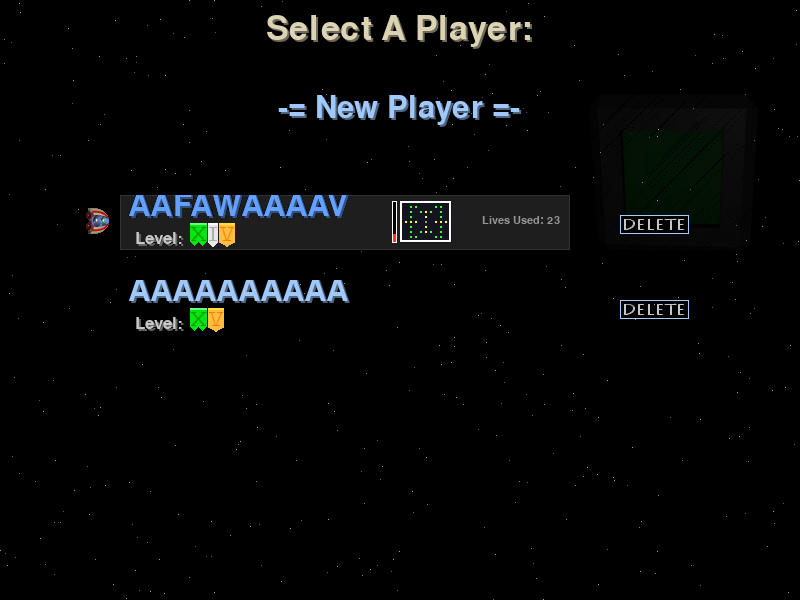
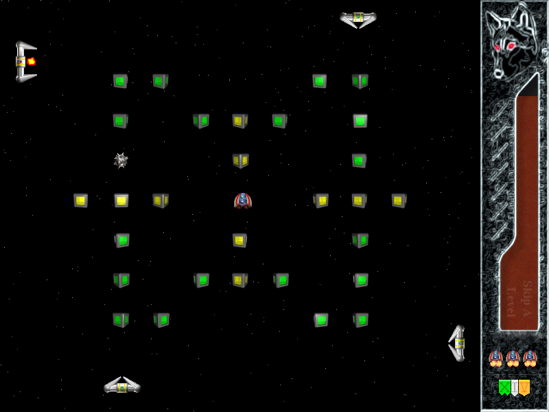
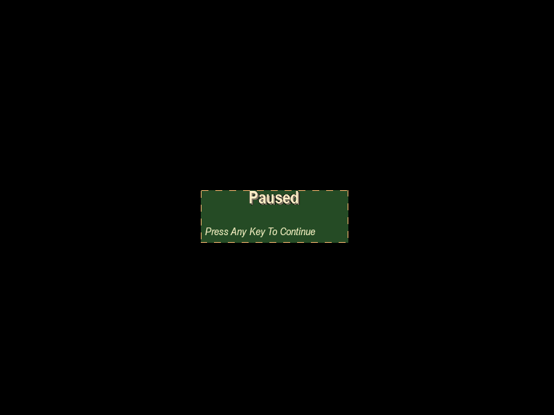
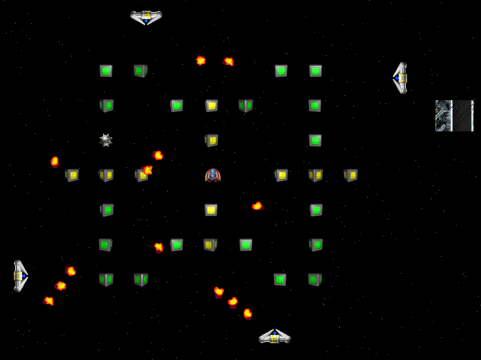

# SolarWolf 主动黑盒测试记录 — 第 01 轮

## 1. 记录说明

| 项目 | 内容 |
| --- | --- |
| 记录类型 | 多局实际游玩后的主动黑盒验证记录 |
| 测试依据 | [SolarWolf 游戏测试计划](SolarWolf-Test-Plan-v1.0.md) 与 [首次探索记录](../Exploratory-Testing/Exploratory-Session-01.md) |
| 被测游戏 | SolarWolf 1.6.0 |
| 测试环境 | Windows 11 家庭中文版（64 位，Build 26200）；Python 3.11.9；Pygame 2.6.1；全屏；800 × 600 像素 |
| 执行方式 | 在首次探索后，通过多局实际游戏主动触发和验证核心行为；未阅读源码，未查询 GitHub Issues。 |
| 结果解释 | 本文件记录已实际观察和验证的结果，不将其伪装为后续才设计的正式 Test Cases，也不以此宣称完整覆盖。 |

## 2. 主动验证结果

| 编号 | 模块 | 主动验证内容 | 实际结果 | 结论 |
| --- | --- | --- | --- | --- |
| BB-ACT-001 | 玩家移动 | 使用方向键向四条边和角落移动。 | 飞船可由方向键控制，且无法离开游戏区域。 | 通过 |
| BB-ACT-002 | 小方块交互 | 分别接触绿色和黄色小方块。 | 绿色小方块一次有效接触即可完成；黄色小方块需要两次有效接触。 | 通过 |
| BB-ACT-003 | 黄色小方块判定 | 在黄色小方块判定区域内快速变向；再离开后重新进入。 | 保持在判定区域内的快速变向不计为第二次接触；必须先离开再进入，才计为第二次有效接触。 | 通过 |
| BB-ACT-004 | 关卡与生命 | 完成当前关卡并进入下一关。 | 进入新关卡时，剩余生命数不重置。 | 通过 |
| BB-ACT-005 | 火球死亡 | 主动接触火球并观察死亡后状态。 | 飞船死亡后在当前关卡固定初始点复活，场上所有火球被清除。 | 通过 |
| BB-ACT-006 | 刺球与护盾 | 接触刺球；在护盾状态下验证刺球交互。 | 刺球可在关卡开始时替换中央小方块出现；接触会死亡，护盾不能免疫刺球。 | 通过 |
| BB-ACT-007 | 生命耗尽 | 消耗全部三个备机/生命机会。 | 所有生命耗尽后，游戏返回主界面。 | 通过 |
| BB-ACT-008 | 时钟与提前完成 | 收集时钟道具；在计时器归零前完成关卡。 | 时钟道具恢复约三分之一的计时器时间；提前完成当前关卡可跳过下一关。 | 通过 |
| BB-ACT-009 | 清屏与护盾道具 | 收集外观类似四个小球的道具和护盾道具。 | 四球道具会清除场上所有火球；护盾激活时提高飞船移动速度，游戏内提示护盾效果结束后有一秒无敌。 | 通过 |
| BB-ACT-010 | 道具移动 | 观察特殊道具的运动和跨边界行为。 | 特殊道具以斜向轨迹移动，到达屏幕边缘后从对应另一侧重新出现。 | 通过 |
| BB-ACT-011 | 存档选择与独立性 | 查看存档选择信息；比较两个同名、同进度存档，并改变其中一个的状态。 | 存档选择界面显示 `Lives Used`；两个同名、同进度存档可独立存在，修改一个不会影响另一个。 | 通过 |
| BB-ACT-012 | 焦点切换与 HUD | 在有/无提示栏状态下切换至其他窗口再返回游戏。 | 可稳定复现右侧 HUD 未完整重绘的问题。详情见 BUG-UI-001。 | 失败 / 已确认缺陷 |

## 3. BUG-UI-001 — 切回游戏窗口后，右侧状态栏未完整重绘

| 字段 | 记录 |
| --- | --- |
| 状态 | 已确认，可稳定复现 |
| 模块 | UI / HUD 渲染 |
| 复现路径 A | 游戏内已有提示栏/消息栏显示时，切换至其他窗口，再切回 SolarWolf。 |
| 复现路径 B | 游戏内没有提示栏时，切换至其他窗口再返回；出现 `Paused` 和 `Press Any Key To Continue` 提示后，再次切换窗口并返回。 |
| 预期结果 | 切回游戏后，右侧 HUD/状态栏完整重绘，并正确反映当前状态。 |
| 实际结果 | HUD/状态栏可能仅进行局部更新，出现缺失文字、局部图形或空白区域。 |
| 可复现性 | 稳定复现。 |
| 严重性 | 高（High）。右侧 HUD 未完整重绘会使玩家无法可靠获取剩余时间、剩余生命等实时关键信息，直接影响判断与操作。 |
| 优先级 | 高（High）。该问题可稳定复现，影响核心游戏过程中的信息获取，应优先修复。 |

### 3.1 游戏记录与缺陷证据索引

| 文件 | 记录内容 |
| --- | --- |
| `Evidence/Game-Records/Game-Record-01-save-selection.png` | 游戏记录：存档选择界面；可见 `Lives Used: 23` 字段。 |
| `Evidence/Game-Records/Game-Record-02-normal-gameplay.png` | 游戏记录：正常游戏界面，右侧 HUD 完整显示。 |
| `Evidence/Game-Records/Game-Record-03-focus-return-paused.png` | 游戏记录：首次切换窗口后返回的暂停界面；可见 `Paused` 与 `Press Any Key To Continue`。该图被 BUG-UI-001 用作复现上下文引用。 |
| `Evidence/Bug-UI-001/BUG-UI-001-02-incomplete-pause-panel.png` | BUG-UI-001 异常状态：暂停提示面板仅剩轮廓，文字和面板内容未完整重绘。 |
| `Evidence/Bug-UI-001/BUG-UI-001-03-incomplete-hud-redraw.png` | BUG-UI-001 异常状态：右侧 HUD 仅显示局部图形和空白区域，未完整重绘。 |

### 3.2 游戏记录照片

### 3.3 BUG-UI-001 证据照片

> 复现上下文引用：上方“首次切屏返回后的暂停提示”游戏记录。

## 4. 后续衔接

- 这些主动黑盒结果将用于编写后续正式 Test Cases，但不等同于正式用例执行数据。
- BUG-UI-001 已满足进入白盒分析的条件：具备明确复现路径和视觉证据。
- 计时器精确临界点、护盾无敌窗口和道具跨边界的帧级判定，不作为手工黑盒主测试项；后续结合源码分析和 pytest 选择性验证。
